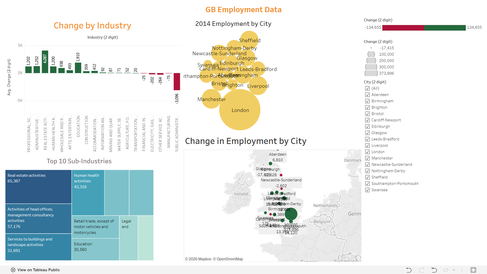
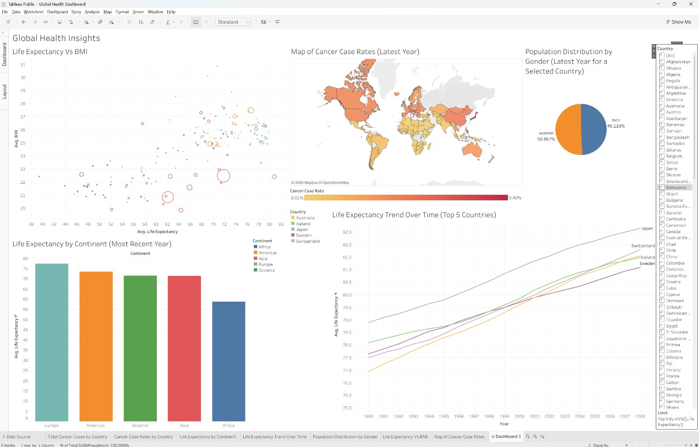
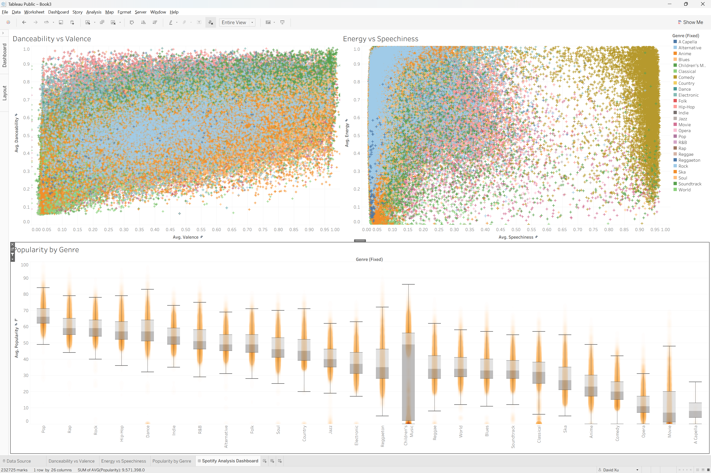

# Tableau – Data Visualisation & Dashboard Projects

## Project Overview

This project was completed during Week 2 of a **Data Technician Bootcamp**, focusing on using **Tableau** to explore datasets, identify trends, and communicate insights through interactive dashboards.

The project involved analysing global employment, healthcare, and Spotify music data, developing practical skills in data visualisation, dashboard design, and data storytelling.

## Skills Demonstrated

- **Interactive Dashboards:** Created dashboards combining multiple visualisations to present key insights in an accessible format.
- **Filters and Interactive Controls:** Used filters, dropdown selections, and Top N filtering to explore specific countries, categories, and time periods.
- **Calculated Fields and Aggregations:** Worked with aggregated measures and percentage-of-total calculations to support comparisons.
- **Data Visualisation:** Created bar charts, line charts, pie charts, scatter plots, and geographical maps.
- **Data Exploration:** Identified trends, patterns, correlations, and differences across datasets.
- **Data Storytelling:** Translated complex data into clear visual narratives to support decision-making.
- **Dashboard Publishing:** Published interactive visualisations using Tableau Public.

## Projects Completed

### 1. GB Employment Dashboard
- Visualised employment changes across UK cities and industries.
- Used geographical maps and charts to compare regional employment trends.
- Created an interactive dashboard to make employment data easier to interpret.

[View GB Employment Dashboard](https://public.tableau.com/views/GBEmploymentData_17900042069790/Dashboard1?:language=en-GB&:sid=&:redirect=auth&:display_count=n&:origin=viz_share_link)

### 2. Global Health Dashboard
- Analysed life expectancy, BMI, population distribution, and cancer rates across countries.
- Used bar charts, line charts, pie charts, scatter plots, and a world map.
- Applied filters to compare countries, continents, and time periods.
- Explored how geographical and demographic differences relate to health outcomes.

[View Global Health Dashboard](https://public.tableau.com/views/GlobalHealthDashboard_17900789572900/Dashboard1?:language=en-GB&:sid=&:redirect=auth&:display_count=n&:origin=viz_share_link)

### 3. Spotify Feature Analysis
- Explored relationships between musical characteristics such as danceability, energy, valence, and speechiness.
- Used scatter plots and comparative visualisations to identify patterns across music genres.
- Investigated differences in song popularity and musical features.

* The box and whisker plot is used for filtering *

[View Spotify Analysis Dashboard](https://public.tableau.com/views/SpotifyFeatureAnalysis_17901539194120/SpotifyAnalysisDashboard?:language=en-GB&:sid=&:redirect=auth&:display_count=n&:origin=viz_share_link)

## Tools & Technologies

- **Tableau Public**
- **Microsoft Excel** (data sources)
- **Data Visualisation**
- **Interactive Dashboard Design**
- **Data Analysis & Storytelling**

## Key Takeaways

This project strengthened my ability to turn raw data into meaningful, interactive visualisations. I gained practical experience selecting appropriate chart types, applying filters, designing dashboards, and communicating analytical findings clearly.

The skills developed are transferable to business intelligence and data analyst roles, particularly when analysing **retail performance, sales trends, customer behaviour, and other business KPIs**.
